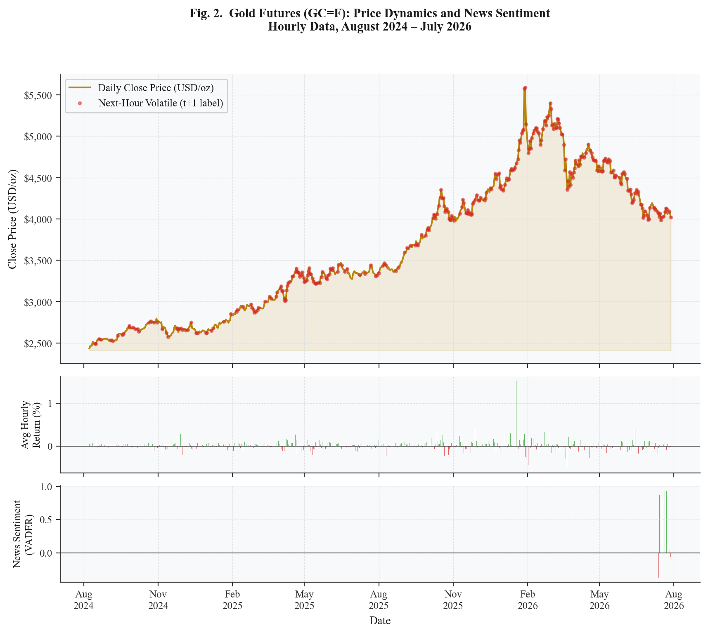
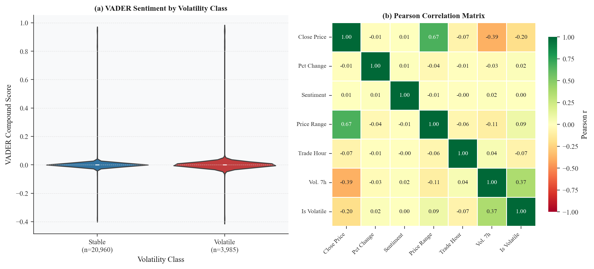
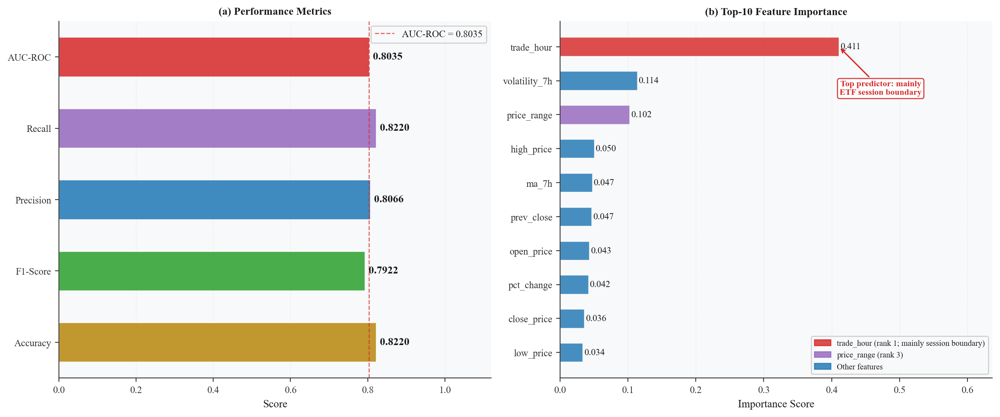
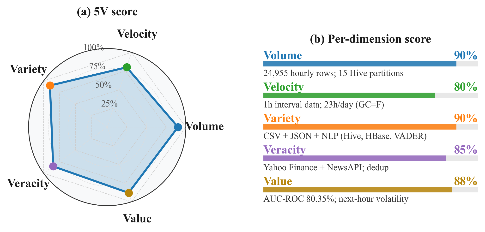
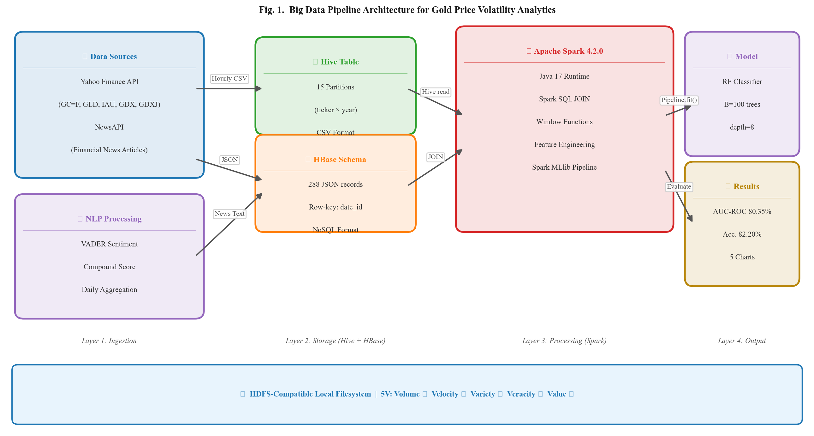

<div align="center">

# 🌟 Predictive Analytics of Gold Price Volatility Using Apache Spark
### *Integrating Multi-Instrument Intraday Data and Global News Sentiment Analysis*

[](https://www.python.org/)
[](https://spark.apache.org/)
[](https://spark.apache.org/mllib/)
[](https://github.com/cjhutto/vaderSentiment)
[](https://www.scopus.com/)
[](https://colab.research.google.com/)

<p align="center">
  <b>🎓 Tesis/Penelitian S2 Magister Informatika — Nusa Putra University</b><br>
  <i>Bidang Keahlian: Big Data Analytics, FinTech & Machine Learning</i>
</p>

---

</div>

## 📌 Ringkasan Eksekutif (Executive Summary)

Penelitian ini mengimplementasikan **pipeline Big Data end-to-end** untuk mengklasifikasikan apakah return emas pada **jam berikutnya (t+1)** melebihi 0,5% (volatil). Data harga **multi-instrumen (Futures + 4 ETF emas)** digabung dengan **sentimen berita (VADER NLP)**, diproses dengan **Apache Spark (PySpark MLlib)** di atas penyimpanan bergaya **Hive** (partisi ticker × tahun) dan **HBase** (row-key JSON) yang diemulasikan pada *file system* lokal (single node).

```
                  ┌────────────────────────────────────────────────────────┐
                  │                 BIG DATA INGESTION                     │
                  │   Yahoo Finance API (Hourly)  +  NewsAPI Global Feed   │
                  └──────────────────────────┬─────────────────────────────┘
                                             │
                                             ▼
                  ┌────────────────────────────────────────────────────────┐
                  │        STORAGE LAYER (emulated on local file system)   │
                  │  Hive-style 15 partitions  +  HBase-style JSON rows     │
                  └──────────────────────────┬─────────────────────────────┘
                                             │
                                             ▼
                  ┌────────────────────────────────────────────────────────┐
                  │         APACHE SPARK DISTRIBUTED COMPUTING             │
                  │      PySpark 4.2.0 | VADER NLP | Feature Pipelines     │
                  └──────────────────────────┬─────────────────────────────┘
                                             │
                                             ▼
                  ┌────────────────────────────────────────────────────────┐
                  │        PREDICTIVE MODELING & VISUAL ANALYTICS          │
                  │  Spark MLlib RF | AUC-ROC 80.35% | MCC 0.38 | Recall 29.78%│
                  └────────────────────────────────────────────────────────┘
```

---

## 🏆 Kinerja Model & Hasil Utama (Key Results)

Model **Random Forest (Spark MLlib, B=100, depth=8)** dievaluasi dengan *hold-out* kronologis 80/20 (19.956 / 4.989 baris) dan *walk-forward* 5 fold dengan embargo 1 hari. Label = volatilitas jam t+1 (tanpa *look-ahead leakage*). Sumber angka: `output/model_evaluation.json`, `output/baseline_ablation.json`, `output/robustness.json`.

### 📊 Hold-out (test set 4.989 baris; 21,6% volatil)

| Metrik | Skor | Catatan |
|:---|:---:|:---|
| AUC-ROC | **80.35%** | 95% CI bootstrap 78.8–81.9% |
| Recall kelas volatil | **29.78%** | Threshold default 0,5; sebagian besar jam volatil terlewat |
| Precision kelas volatil | 71.02% | |
| MCC | **0.38** | Majority class: 0.00 |
| Balanced accuracy | 63.21% | |
| Accuracy | 82.20% | Baseline majority class: 78.39% |
| Recall dengan threshold 0,24 (di-tuning di slice validasi) | 68.55% | MCC 0.43 |

### ⚖️ Perbandingan & Robustness

| Setting | AUC-ROC | Catatan |
|:---|:---:|:---|
| RF (hold-out) | 80.35% | Lebih baik dari LR dan aturan historis (uji DeLong p < 0,001) |
| Gradient-Boosted Trees | 79.31% | RF sedikit lebih baik (DeLong p = 0,012) |
| Logistic Regression | 72.13% | |
| Aturan volatilitas historis (σ7h > θ) | 70.36% | Recall tinggi (67.72%), banyak alarm palsu |
| Walk-forward RF (5 fold) | 81.07 ± 2.98% | |
| Target *session-aware* | 76.31% | trade_hour turun ke 6.21%; fitur temporal hanya +0,53 poin |
| AUC per instrumen | GC=F 68.21% · GDXJ 73.43% · GDX 74.38% · GLD 80.84% · IAU 82.43% | Penggabungan instrumen tidak membantu GC=F |

**Temuan utama:** importance `trade_hour` (41.06%) sebagian besar berasal dari *overnight gap* di batas sesi ETF (bar terakhir 15:00 ET → bar pembukaan esok hari), bukan dari *intraday seasonality* murni. Fitur sentimen tidak berpengaruh, karena 292 artikel hanya jatuh di 9 hari (1,6% baris).

### 🔍 Top-5 Feature Importance (Gini)
1. `trade_hour` — 41.06% (terutama efek batas sesi ETF)
2. `volatility_7h` — 11.35%
3. `price_range` — 10.25%
4. `high_price` — 5.02%
5. `ma_7h` — 4.74%

---

## 🔬 Indikator 5V Big Data (terukur)

| V | Indikator |
|:---|:---|
| **Volume** | 24.955 baris *hourly*, 15 partisi bergaya Hive (ticker × tahun), 292 dokumen JSON bergaya HBase |
| **Velocity** | Bar per jam; training RF 20,3 s (1 core) → 10,6 s (8 thread) pada single node |
| **Variety** | CSV, JSON, dan teks berita; 5 instrumen |
| **Veracity** | Harga dari bursa (Yahoo Finance); 10 baris tidak lengkap dibuang |
| **Value** | AUC-ROC 80.35%; recall volatil 29.78% (68.55% dengan threshold yang di-tuning) |

---

## 📈 Galeri Visualisasi Penelitian (High-Res Charts)

Visualisasi grafik diproduksi dengan resolusi tinggi (300 DPI) dalam format publikasi:

| Chart | Deskripsi |
|:---:|:---|
|  | **Chart 1: Tren Fluktuasi Harga Multi-Instrumen & Distribusi Sentimen Berita Global** |
|  | **Chart 2: Analisis Sentimen VADER vs Volatilitas Harga Emas** |
|  | **Chart 3: Dashboard Kinerja Model Spark MLlib & Feature Importance** |
|  | **Chart 4: Radar 5V (rubrik penilaian sendiri; tidak dipakai di paper karena subjektif)** |
|  | **Chart 5: Diagram Alir Pipeline Terdistribusi End-to-End** |

---

## 📦 Dataset Multi-Instrumen

Dataset terstruktur mencakup 5 instrumen emas global (periode Agustus 2024 – Juli 2026):

| Simbol Ticker | Nama Instrumen | Granularitas | Baris Data |
|:---:|:---|:---:|:---:|
| **`GC=F`** | Gold Futures COMEX (Primary) | 1 Jam (23h/hari) | 11.275 |
| **`GLD`** | SPDR Gold Shares ETF | 1 Jam | 3.420 |
| **`IAU`** | iShares Gold Trust ETF (BlackRock) | 1 Jam | 3.420 |
| **`GDX`** | VanEck Gold Miners ETF | 1 Jam | 3.420 |
| **`GDXJ`** | VanEck Junior Gold Miners ETF | 1 Jam | 3.420 |
| **TOTAL** | **Multi-Instrument Time-Series** | **Hourly** | **24.955** |

---

## 📂 Struktur Repositori

```bash
├── data/
│   ├── raw/                     # Data mentah: gold_price_raw.csv & news_raw.json
│   └── processed/               # merged_dataset.csv, skor sentimen, partisi Hive/HBase (lokal)
├── output/
│   ├── charts/                  # Grafik visualisasi (PNG)
│   ├── model_evaluation.json    # Metrik RF hold-out
│   ├── baseline_ablation.json   # Baseline, ablasi, kontrol per instrumen
│   └── robustness.json          # Session-aware, imbalance, GBT, uji statistik, walk-forward, benchmark
├── scripts/
│   ├── 01_collect_gold_price.py # Yahoo Finance (hourly) -> partisi bergaya Hive
│   ├── 02_collect_news.py       # NewsAPI -> JSON bergaya HBase (isi NEWS_API_KEY sendiri)
│   ├── 03_sentiment_analysis.py # Skoring sentimen VADER
│   ├── 04_spark_ml_analysis.py  # Fitur Spark Window Functions + Random Forest
│   ├── 05_visualization.py      # Grafik analisis
│   ├── 06_baselines_ablation.py # Baseline, ablasi temporal/sentimen, GC=F-only & ETF-only
│   └── 07_robustness.py         # Target session-aware, threshold/class weight, GBT, DeLong,
│                                #   bootstrap, walk-forward + embargo, sensitivitas θ, benchmark
├── fix_chart3.py                # Grafik metrik & feature importance
├── COLAB_NOTEBOOK.py            # Standalone pipeline siap Google Colab
├── gold_price_research.ipynb    # Jupyter Notebook interaktif
├── PANDUAN_GOOGLE_COLAB.md      # Panduan eksekusi di Cloud Google Colab
├── RINGKASAN_PENELITIAN_UNTUK_AI.md # Ringkasan riset lengkap
├── requirements.txt             # Dependensi Python
└── README.md                    # Dokumentasi utama proyek
```

---

## ⚡ Panduan Menjalankan (Quick Start)

### 1. Kloning Repositori
```bash
git clone https://github.com/asepsurahman03/Predictive-Analytics-Volatilitas-Harga-Emas-menggunakan-Apache-Spark-NLP-Sentiment..git
cd Predictive-Analytics-Volatilitas-Harga-Emas-menggunakan-Apache-Spark-NLP-Sentiment.
```

### 2. Pasang Dependensi
```bash
pip install -r requirements.txt
```

### 3. Eksekusi Pipeline Otomatis
```bash
# Jalankan seluruh modul secara sekuensial
python scripts/01_collect_gold_price.py
python scripts/02_collect_news.py
python scripts/03_sentiment_analysis.py
python scripts/04_spark_ml_analysis.py
python scripts/05_visualization.py
python scripts/06_baselines_ablation.py   # ±15 menit (Spark local)
python scripts/07_robustness.py           # ±30 menit (±40 fit RF + benchmark)
```

> Catatan: skrip 06–07 membaca `data/processed/merged_dataset.csv`, sehingga bisa dijalankan tanpa mengambil ulang data. Angka RF bisa sedikit berbeda antar-run (mis. AUC 80.35% vs 80.39%) karena partisi data Spark.

> 💡 **Ingin menjalankan di Google Colab?** Buka [PANDUAN_GOOGLE_COLAB.md](PANDUAN_GOOGLE_COLAB.md) untuk langkah *1-click run* gratis di GPU/CPU cloud!

---

## 🛠️ Stack Teknologi

* **Big Data Distributed Engine**: [Apache Spark 4.2.0](https://spark.apache.org/) (PySpark)
* **Data Storage**: partisi bergaya Hive dan row-key JSON bergaya HBase, diemulasikan di file system lokal (HDFS-compatible)
* **Machine Learning**: Spark MLlib (`VectorAssembler`, `StandardScaler`, `RandomForestClassifier`)
* **Natural Language Processing**: VADER Sentiment Analysis (`vaderSentiment`)
* **Data Retrieval**: `yfinance`, `NewsAPI`, `requests`
* **Visualisasi Ilmiah**: `matplotlib`, `seaborn`

---

## ✍️ Sitasi & Peneliti

Jika penelitian atau kode ini bermanfaat bagi studi Anda, silakan rujuk:

```bibtex
@mastersthesis{asepsurahman2026goldvolatility,
  author       = {Asep Surahman},
  title        = {Predictive Analytics of Gold Price Volatility Using Apache Spark: Integrating Multi-Instrument Intraday Data and Global News Sentiment Analysis},
  school       = {Magister Informatika, Universitas Nusa Putra},
  year         = {2026},
  note         = {Big Data Analytics Research}
}
```

<div align="center">
  <sub>Dibuat untuk memenuhi tugas & publikasi <b>Magister Teknik Informatika - Universitas Nusa Putra</b>.</sub>
</div>
